 

I'm a **Computer Science Engineering student** at ITER, SOA University, building practical, intelligent software with **AI/ML, Generative AI and modern full-stack technologies**. I turn real-world problems into reliable, scalable products: LLM-powered apps, RAG systems, predictive analytics, computer vision and production-oriented backends.

I value clean architecture, performance, security and cost-efficient engineering.

 

Synced automatically every 10 minutes &middot; the dashboard also refreshes itself live

 

<table>
<tr>
<td width="50%"></td>
<td width="50%"></td>
</tr>
<tr>
<td width="50%"></td>
<td width="50%"></td>
</tr>
</table>

<b>Explore project details</b> &nbsp;(click to expand)

 

<b>DineDeck</b> &middot; restaurant operations ecosystem

- Restaurant discovery, digital and QR-based ordering
- Partner and admin dashboards, POS and Kitchen Display System (KDS)
- Real-time order and kitchen management, billing and GST workflows, settlements
- **Stack:** Kotlin, Jetpack Compose, React, TypeScript, Fastify, Node.js, PostgreSQL, Prisma, Redis, WebSockets, Electron, Docker

<b>DataCure</b> &middot; healthcare management and predictive analytics

- Patients, doctors, appointments, billing and inventory management
- Predictions for readmission risk, appointment no-shows, patient flow and medicine demand
- **Stack:** React, Python, Flask, PostgreSQL, Scikit-learn, Firebase, Redis, Docker, Nginx, AWS EC2 and RDS

<b>DRAI-AI</b> &middot; computer vision detection

- Person, safety-helmet and fire detection with YOLOv8
- Dataset preparation and annotation, training and evaluation, real-time webcam inference
- **Stack:** Python, PyTorch, YOLOv8, Ultralytics, OpenCV, Pillow, Pandas

<b>ARTHSAVORA</b> &middot; AI-powered personal finance

- Expense tracking and automated categorization, budgets, goals and analytics
- Receipt and document OCR, ML-driven financial insights, secure JWT-based APIs
- **Stack:** Python, FastAPI, React, Vite, MongoDB, Scikit-learn, Statsmodels, Tesseract OCR, Supabase, Google Generative AI

 

<b>Full skill inventory</b> &nbsp;(click to expand)

| Area | Skills |
| --- | --- |
| **AI / ML** | Machine Learning, Deep Learning, Predictive Analytics, Feature Engineering, Time-Series Forecasting, Anomaly Detection, Computer Vision, Object Detection |
| **GenAI / LLM** | LLM applications, RAG, Prompt Engineering, AI automation, Intelligent Document Processing, OCR extraction, Hugging Face, LangChain |
| **Frameworks** | TensorFlow, PyTorch, Scikit-learn, XGBoost, Pandas, NumPy, OpenCV, Statsmodels |
| **Frontend** | React, Vite, TypeScript, Tailwind CSS, Zustand, React Router, Recharts |
| **Backend** | FastAPI, Flask, Node.js, Express, Fastify, REST APIs, JWT auth |
| **Data and Cloud** | PostgreSQL, MySQL, MongoDB, Firebase, Supabase, Redis, Docker, Nginx, AWS EC2/RDS, Vercel, Netlify, Render, Railway |
| **Mobile and Desktop** | Kotlin, Jetpack Compose, Material Design 3, Electron |

 

Open to discussing AI architectures, backend systems, open-source work and engineering roles.

  

