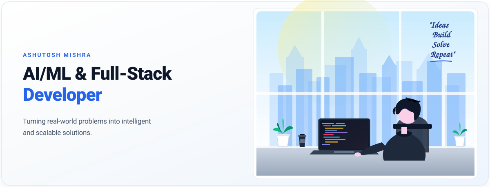
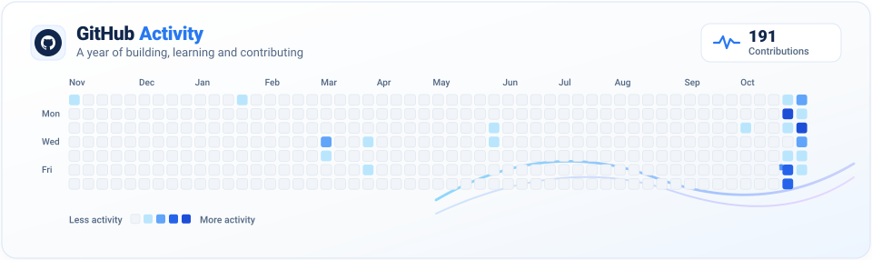
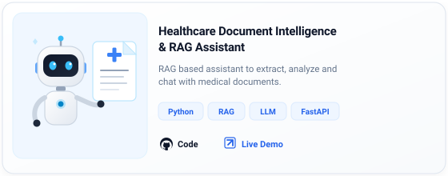
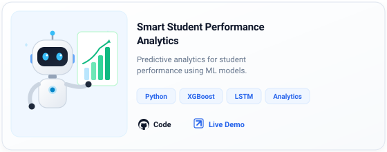
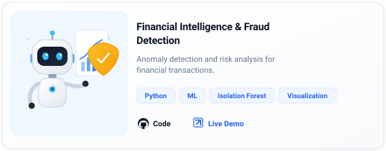
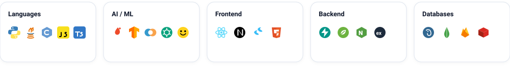
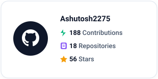
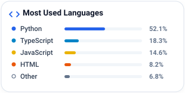
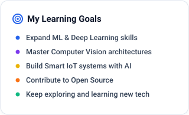
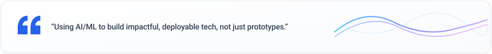

&nbsp;
&nbsp;
&nbsp;

 

###  About Me

I'm a **Computer Science Engineering student** with a strong interest in **AI/ML**, **backend systems**, and **real-world applications**. I love building products that solve meaningful problems, exploring new technologies, and turning ideas into working solutions.

 

 

<table width="100%" border="0" cellpadding="0" cellspacing="0">
<tr>
<td style="border: none;"><h3> Featured Projects</h3></td>
<td align="right" style="border: none;"><a href="https://github.com/Ashutosh2275?tab=repositories"><b>View All Repositories ➔</b></a></td>
</tr>
</table>

<table width="100%" border="0" cellpadding="6" cellspacing="0">
<tr>
<td width="50%" valign="top">

<a href="https://github.com/Ashutosh2275/Datacure"><b>🐙 View Code</b></a>&nbsp;&nbsp;•&nbsp;&nbsp;<a href="https://heyashutosh.netlify.app/" target="_blank" rel="noopener noreferrer"><b>🚀 Live Demo</b></a>

</td>
<td width="50%" valign="top">

<a href="https://github.com/Ashutosh2275/Datacure"><b>🐙 View Code</b></a>&nbsp;&nbsp;•&nbsp;&nbsp;<a href="https://heyashutosh.netlify.app/" target="_blank" rel="noopener noreferrer"><b>🚀 Live Demo</b></a>

</td>
</tr>
<tr>
<td width="50%" valign="top">

<a href="https://github.com/Ashutosh2275/DRAI-AI"><b>🐙 View Code</b></a>&nbsp;&nbsp;•&nbsp;&nbsp;<a href="https://heyashutosh.netlify.app/" target="_blank" rel="noopener noreferrer"><b>🚀 Live Demo</b></a>

</td>
<td width="50%" valign="top">

<a href="https://github.com/Ashutosh2275/ARTHSAVORA"><b>🐙 View Code</b></a>&nbsp;&nbsp;•&nbsp;&nbsp;<a href="https://heyashutosh.netlify.app/" target="_blank" rel="noopener noreferrer"><b>🚀 Live Demo</b></a>

</td>
</tr>
</table>

 

###  Technical Skills

<table width="100%" border="0" cellpadding="6" cellspacing="0">
<tr>
<td width="20%" valign="top">
<b>Languages</b> 
• Python 
• Java 
• C / C++ 
• JavaScript (ES6+) 
• TypeScript
</td>
<td width="20%" valign="top">
<b>AI / ML &amp; GenAI</b> 
• PyTorch &amp; TF 
• Scikit-Learn 
• LangChain &amp; RAG 
• OpenAI / Hugging Face 
• Computer Vision (YOLO)
</td>
<td width="20%" valign="top">
<b>Frontend</b> 
• React.js 
• Next.js 
• Tailwind CSS 
• HTML5 &amp; CSS3 
• Redux / Vite
</td>
<td width="20%" valign="top">
<b>Backend</b> 
• FastAPI 
• Node.js &amp; Express 
• Spring Boot 
• RESTful APIs 
• Microservices
</td>
<td width="20%" valign="top">
<b>Databases &amp; Cloud</b> 
• PostgreSQL &amp; SQL 
• MongoDB 
• Firebase / Redis 
• Docker &amp; Git/GitHub 
• AWS &amp; Linux
</td>
</tr>
</table>

 

<table width="100%" border="0" cellpadding="4" cellspacing="0">
<tr>
<td width="33%" valign="top" align="center">

</td>
<td width="34%" valign="top" align="center">

</td>
<td width="33%" valign="top" align="center">

</td>
</tr>
</table>

 

<h3>📬 Let's Connect</h3>

Whether discussing AI architectures, backend systems, open-source projects, or engineering roles:

&nbsp;
&nbsp;
&nbsp;

 

